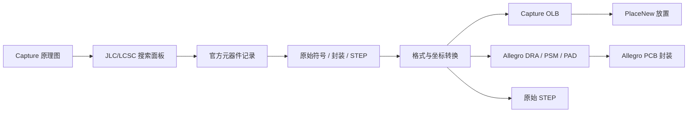

# JLC2Cadence

将立创商城（LCSC/JLCPCB）元器件搜索、原始 CAD 资源转换和 Cadence Capture 放置连接起来的开源工具。

[](https://www.python.org/)
[](https://www.cadence.com/)
[](LICENSE)

> 本项目是独立的社区工具，与 LCSC、JLCPCB、EasyEDA、Cadence 或 OrCAD 没有隶属关系。

## 它解决什么问题

在 Capture 原理图页面里搜索型号或 LCSC C 编号，查看符号、封装和 STEP 预览，然后把元件放置到当前页面。下载后的资源会保存到本地库目录，供 Capture 和 Allegro 继续使用。


它的转换策略以立创关联的原始数据为准：只做格式、单位和坐标系统所需的转换，不重画封装、不改尺寸、不替换 STEP。源数据不完整时，工具会保留明确的失败原因，例如“没有 CAD 文件，无法导入”或“由于是异形结构，当前无法生成”。

## 主要功能

- Capture 右侧 `JLC/LCSC` 控制栏；没有 CEF 接口时回退到 Tcl/Tk 窗口。
- LCSC/JLC 关键词、型号和 C 编号搜索，分页、厂商、封装和库存筛选。
- 复用会话缓存和磁盘缓存；精确 C 编号在本地缓存命中时不重复访问网络。
- 原始符号、封装、STEP 预览，以及 Capture `PlaceNew` 交互放置。
- 输出 Capture OLB、Allegro DRA/PSM/PAD 和原始 STEP 文件。
- 缺失 CAD、缺失 STEP、异形结构、字体和目标格式限制都会写入报告。
- Windows 安装器支持 Cadence 17.2/17.4 选择、修复、升级、回滚和卸载。
- 更新模块使用签名清单、Ed25519、公钥固定、HTTPS、大小和 SHA-256 校验。

## 工作流



## 预览

| Capture 符号 | Allegro 封装 | STEP 三维模型 |
|---|---|---|
|  |  |  |

放置后的 Capture 页面示例：


## 安装

### Windows 安装包

发布包包含自带的 Python 运行时，用户不需要另装 Python、Node.js 或 Codex。运行 `JLC2Cadence-<version>-Setup.exe`，选择已安装的 Cadence 根目录和元件库目录，然后重新启动 Capture。

安装器会向所选 Cadence 根目录注册一个受所有者标记保护的自动加载脚本：

```text
<CadenceRoot>/tools/capture/tclscripts/capAutoLoad/jlc2capture_init.tcl
```

### 从源码运行

要求：Windows、Cadence Capture 17.2 或 17.4、Python 3.10+、Node.js 18+（只用于构建/验证面板）。

```powershell
py -3.11 -m venv .venv
.\.venv\Scripts\python.exe -m pip install -e .
npm --prefix capture_plugin/web ci --ignore-scripts
```

在 Capture 的 Command Window 中加载插件：

```tcl
source -encoding utf-8 {C:/path/to/jlc2cadence/capture_plugin/jlc2capture.tcl}
```

随后打开：

```text
JLC/LCSC -> Search Components...
```

支持 CEF 的 Capture 会在右侧创建 `JLC / LCSC` 控制栏。首次安装或更新后需要重启 Capture；加载插件不会打开、保存或修改任何工程文件。

## 使用

1. 打开目标 Capture 工程和原理图页面。
2. 选择 `JLC/LCSC -> Search Components...`。
3. 输入型号、关键词或 C 编号并选择结果。
4. 查看符号、封装和 STEP 预览。
5. 点击 `下载资源`，等待本地库生成。
6. 点击 `放置原理图`，在当前页面完成 Capture 交互放置。
7. 在 Allegro 中把生成的 `allegro/symbols`、`allegro/padstacks` 和 `3d` 加入对应库路径。

生成目录示例：

```text
library/
├─ cadence-17.4/
│  ├─ parts/Cxxxxx/<build>/capture/*.olb
│  ├─ allegro/symbols/*.dra
│  ├─ allegro/symbols/*.psm
│  ├─ allegro/padstacks/*.pad
│  ├─ 3d/*.step
│  └─ parts/Cxxxxx/<build>/reports/source_provenance.json
└─ cadence-17.2/
```

## 离线转换器

旧的批处理转换流程仍然可用，适合审查 JLC EDA Pro 导出的 Altium ASCII、PADS 或 EasyEDA Pro 数据：

```powershell
$env:PYTHONPATH = "$PWD/src"
python -m jlc2cadence.cli inspect --input .\tests\fixtures\demo_altium
python -m jlc2cadence.cli convert `
  --input .\tests\fixtures\demo_altium `
  --models .\tests\fixtures\demo_altium `
  --out .\out_demo
```

生成的 `capture/`、`allegro/`、`3d/`、`reports/` 和 `scripts/` 应先审查，再使用 `--run-cadence` 调用本机 Cadence 工具。

## 源数据边界

项目刻意不制作替代几何：

- 没有立创原始 CAD 时，不伪造符号或封装；
- 异形、自交或目标格式无法表达的结构会失败并记录原因；
- 缺少 STEP 时保留可用的符号/封装，并明确标记三维模型缺失；
- 位号前缀只使用元器件原始属性中能核实的类型；
- 生成的 DRA/PSM/PAD 仍需在目标 Cadence/Allegro 版本和制造规则下复核。

## 测试

不依赖 Cadence 的回归测试：

```powershell
python -m unittest discover -s tests -p "test_*.py"
python -m unittest discover -s tools/update_server -p "test_server.py"
```

面板测试：

```powershell
npm --prefix capture_plugin/web ci --ignore-scripts
npm --prefix capture_plugin/web test
```

Cadence 原生验收需要本机安装 Capture/Allegro，并且必须使用独立测试工程。公开仓库不包含用户工程、缓存、安装包、STEP 大模型或本机验收输出。

## 在线更新

更新器使用静态 HTTPS 文件站点：签名的 `manifest.json`、不可变版本目录、Ed25519 公钥、大小和 SHA-256 校验。生产环境的私钥不应进入仓库或安装包。

- [Windows 使用说明](docs/windows_user_guide_zh.md)
- [正式更新站点部署说明](packaging/release/PRODUCTION_DEPLOYMENT_ZH.md)
- [更新服务器说明](tools/update_server/README.md)

## 目录

| 路径 | 内容 |
|---|---|
| `src/jlc2cadence` | 搜索、缓存、解析、转换和验证后端 |
| `capture_plugin` | Capture Tcl/Tk、CEF 面板和安装脚本 |
| `tests` | Python 后端和转换器回归测试 |
| `tools/update_server` | 本地静态发布目录服务器和测试 |
| `packaging/windows` | Windows 安装器/升级/卸载脚本 |
| `docs` | 中文安装、使用和部署文档 |
| `examples` | 最小输入示例 |

## 贡献

欢迎提交问题和 Pull Request。涉及源几何的修改应附带输入记录、转换报告和对应的回归测试；不要提交用户 Cadence 工程、下载缓存、私钥、生产更新地址或未经授权的供应商资源。

## 许可证和第三方声明

项目代码采用 MIT 许可证，依赖项和立创/EasyEDA 资源仍受各自许可证、服务条款和版权约束。项目不会把供应商原始库或生产更新私钥作为仓库内容重新发布。

- [EasyEDA 文件格式文档](https://docs.easyeda.com/en/DocumentFormat/2-EasyEDA-Schematic-File-Format/)
- [easyeda2kicad.py](https://github.com/uPesy/easyeda2kicad.py)
- [Python](https://www.python.org/)
- [Three.js](https://threejs.org/)

