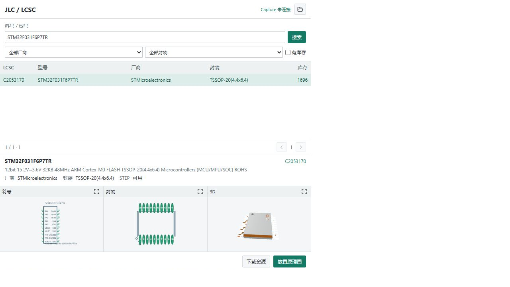
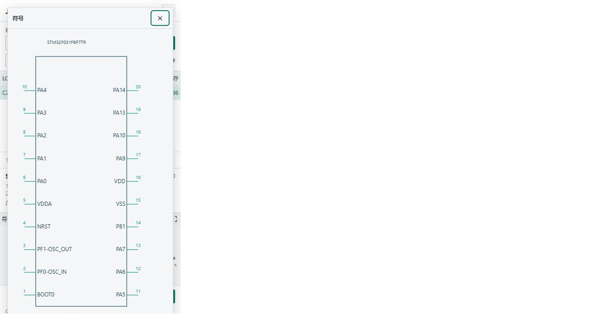
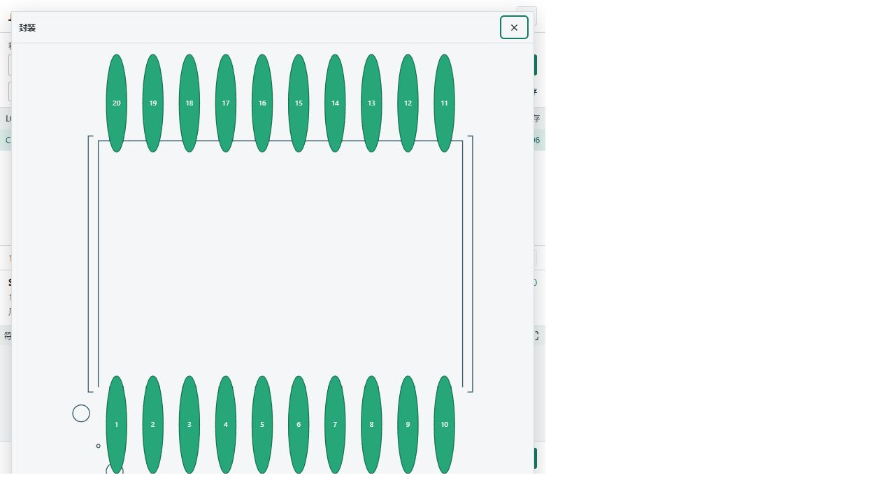
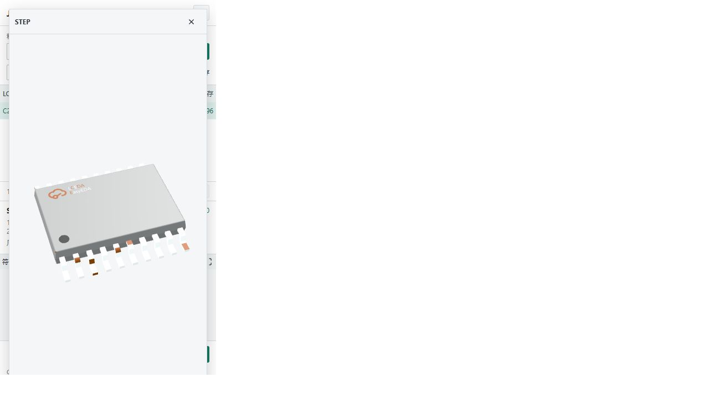
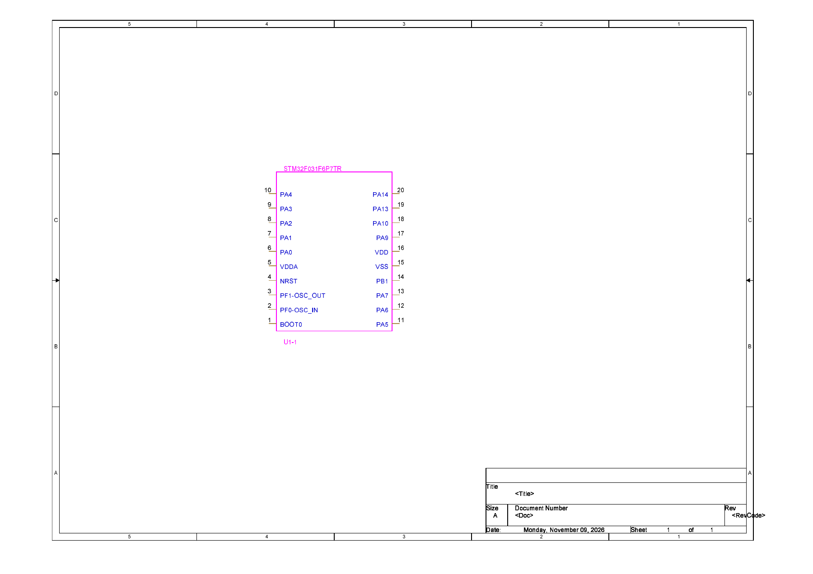
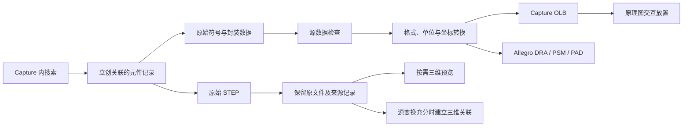

# Cadence Component Forge

**在 Capture 中搜索立创元器件，将原始符号、PCB 封装和 STEP 接入 Cadence 工作流。**

项目中的应用名称是 **JLC2Cadence**。它在 OrCAD Capture 内提供 `JLC / LCSC` 搜索面板，把供应方关联的 CAD 数据转换成 Capture 与 Allegro 可使用的本地库文件，减少查找、下载、转换和手动配置路径的重复操作。

Search LCSC components inside OrCAD Capture, convert the linked source libraries, and keep symbols, Allegro footprints and original STEP models together.

[](https://github.com/BH4ME/cadence-component-forge/actions/workflows/ci.yml)
[](https://github.com/BH4ME/cadence-component-forge/releases)
[](#compatibility)
[](LICENSE)

[下载安装](#quick-start) · [使用流程](#usage) · [文件说明](#library-files) · [常见问题](#faq) · [验证记录](#validation) · [开发与贡献](#development)

> **当前发布：v0.49.1，预发布。** 已在 Capture 17.4 S039 的独立工程中完成限定范围验收；17.2、其他补丁版本和干净客户环境仍需实测。请先在测试工程中评估。详细结果与未覆盖项见[验证范围](#validation)。
>
> 本项目是独立的社区工具，与 LCSC、JLCPCB、EasyEDA、Cadence 或 OrCAD 没有隶属关系。

## 这个项目能做什么

适合使用 **Capture 画原理图、Allegro 设计 PCB**，希望按型号或立创 C 编号查找元件并维护本地库的用户。

| 能力 | 实际行为 |
|---|---|
| 在 Capture 内搜索 | 支持 C 编号、型号、关键词、分页，以及厂商、封装和库存筛选 |
| 预览后选择 | CEF 面板先显示原始符号与封装的二维预览，需要时再点击“加载 3D” |
| 放置原理图 | 准备资源、生成 OLB，再进入 Capture 的交互放置状态，由用户在目标页面落点 |
| 准备 Allegro 资源 | 生成 DRA、PSM、PAD，保存原始 STEP，并在源数据充分时建立三维关联 |
| 管理本地库 | 复用搜索与转换缓存，按元件和构建指纹保存来源报告，检查生成资源完整性 |
| 登记库路径 | 登记 Capture 封装路径和 Allegro 的 `psmpath`、`padpath`、`steppath` |
| 明确说明失败 | 区分无 CAD、缺 STEP、当前不支持的结构、网络失败和原生工具失败 |

本项目提供元件库与 Capture 放置入口。把原理图传入 PCB、布线以及板级检查仍使用 Cadence 自身的设计流程。

## 界面与资源预览

下面是搜索面板的离线界面示例，因此图中显示“Capture 未连接”；在 Capture 内从菜单打开后才会建立宿主连接。截图用于展示布局，具体按钮和状态以安装版本为准。



| 符号预览 | 封装预览 | STEP 三维预览 |
|---|---|---|
|  |  |  |

<details>
<summary>查看 Capture 原理图中的符号显示示例</summary>

这是早期独立测试工程的显示截图，用于说明符号在 Capture 中的外观；v0.49.1 的保存、引脚和位号验证以[本轮报告](docs/qa/v0.49.1-capture-placement.md)为准。



</details>

<a id="quick-start"></a>
## 快速开始

### 1. 下载 Windows 安装包

**普通用户下载 [JLC2Cadence-0.49.1-Setup.exe](https://github.com/BH4ME/cadence-component-forge/releases/download/v0.49.1/JLC2Cadence-0.49.1-Setup.exe)。** 安装包自带 Python 运行时和所需依赖，不需要另装 Python、Node.js、npm 或 Codex。

其他版本及说明见 [GitHub Releases](https://github.com/BH4ME/cadence-component-forge/releases)。当前版本是预发布，不要把 GitHub 的 `/releases/latest` 当作当前预发布版的固定下载地址。

| Release 中的文件 | 用途 |
|---|---|
| `JLC2Cadence-<版本>-Setup.exe` | 常规安装、升级和修复，普通用户选这个 |
| `JLC2Cadence-<发布标识>-payload.zip` | 完整发布内容，供部署或检查；解压本身不会自动向 Capture 注册插件 |
| `build-info.json` | 发布内容、文件哈希和运行时来源记录 |
| `SHA256SUMS.txt` | 校验下载文件是否完整 |

### 2. 安装到已有的 Cadence

1. 本机先安装可正常使用的 Capture / Allegro。安装包不包含 Cadence。
2. 运行 Setup，选择实际的 Cadence 根目录，例如 `C:\Cadence\SPB_17.4`。只选择本机已安装的版本。
3. 选择元件库目录，例如 `D:\JLC2Cadence\library`。原生工具可能受路径长度限制，建议使用较短的目录。
4. 保存自己的工作并重新启动 Capture。安装器不会强行关闭正在运行的 Cadence。
5. 打开一个测试工程及原理图页面，选择 **`JLC/LCSC → Search Components...`**。

支持 CEF 的 Capture 会在**右侧控制栏**显示搜索面板；所需浏览器接口不可用时，会回退到独立 Tcl/Tk 搜索窗口。

安装器仅向选定的 Cadence 目录注册本扩展的自动加载入口：

```text
<CadenceRoot>/tools/capture/tclscripts/capAutoLoad/jlc2capture_init.tcl
```

安装过程不需要打开或保存已有工程。安装、修复、卸载及目录说明见 [Windows 使用指南](docs/windows_user_guide_zh.md)。

<a id="compatibility"></a>
## 运行环境与兼容性

| 项目 | 当前范围 |
|---|---|
| 操作系统 | Windows x64；安装包包含 Python 3.11.9 x64 运行时 |
| Capture 17.4 | 已在 **17.4-2019 S039** 进行原生建库、放置和保存回读验证 |
| Capture 17.2 | 安装器和版本隔离已有适配；**尚未完成 17.2 实机运行验收** |
| 其他 Cadence 版本 / 补丁 | 尚未建立兼容性结论 |
| Allegro 原生工具 | 生成 PSM/PAD、处理 STEP 关联等需要本机相应 Cadence 工具可用 |
| 网络 | 首次搜索和下载资源需要访问供应方服务；已有缓存可减少重复请求 |
| 开发环境 | 推荐 Windows x64、Python 3.11、Node.js 20；普通安装用户无需配置这些工具 |

GitHub CI 在 Linux 上运行可移植的 Python 与面板回归测试，**不代表在 Linux 上运行了 Capture / Allegro**。

<a id="usage"></a>
## 从搜索到放置

以 `C2053170` 为例：

1. **激活目标页面。** 在 Capture 中打开独立测试工程的原理图页，再打开 `JLC/LCSC` 面板。
2. **搜索。** 输入 C 编号、型号或关键词，点击“搜索”。搜索列表不会自动下载全部结果。
3. **选择与预览。** 点击某一行查看符号和封装。CEF 面板默认先准备二维数据；需要三维时点击“加载 3D”。
4. **按目的选择动作。** 只想准备本地库，点“下载资源”；准备放到当前原理图，直接点“放置原理图”。**不必先下载再放置**，放置动作会自动准备所需资源。
5. **在画布落点。** 等待 Capture 进入交互放置，在目标原理图页单击放下元件，再按 `Esc` 退出连续放置。
6. **核对结果。** 检查引脚编号、元件属性和 `PCB Footprint`，按自己的工作流保存工程。

放置前会核对目标工程与页面。页面关闭或目标失效时会拒绝继续，避免把元件放到意外的图纸中。

Tk 备用窗口与 CEF 面板的资源准备方式有所不同：Tk 仍使用完整 STEP 准备流程，因此首次预览可能更久。

### 在 Allegro 中使用

导入完成后，Capture 元件的 `PCB Footprint` 属性填写对应的封装名，例如 `c2053170_tssop_20_l6_5_f2bd621e`，**不带 `.psm` 后缀**。

程序会登记生成资源的查找路径，并保留原有路径。已经运行的 Allegro 需要重新启动，才能读取新配置。之后按正常的原理图到 PCB 流程导入设计、查找并放置封装。

有原始 STEP 和可核实的绑定变换时会准备三维关联；**只有 STEP、缺少原始位置/旋转数据时，会保留文件并提示，不猜测绑定坐标**。在目标 PCB 中检查模型方向、引脚和安装面后再用于设计。

<a id="library-files"></a>
## 会生成哪些文件

| 文件 | 用途 | 常用打开方式 |
|---|---|---|
| `.olb` | Capture 原理图符号库 | Capture 中加载、选取并放置符号 |
| `.dra` | Allegro 可编辑的封装源文件 | Allegro 封装编辑环境 |
| `.psm` | Allegro 放置使用的编译封装 | 通过封装搜索路径供 PCB 放置使用 |
| `.pad` | Padstack，描述焊盘和孔等结构 | Allegro / Padstack Editor |
| `.step` / `.stp` | 供应方原始三维模型 | Allegro 三维流程或 STEP 查看工具 |
| `.glb` | 从 STEP 派生的面板显示网格 | 内嵌三维预览；不是原始 STEP 的替代文件 |
| `source_provenance.json` | 来源、转换策略及原始资源哈希 | 文本编辑器，用于追溯 |
| `allegro_paths.env` | `psmpath`、`padpath`、`steppath` 配置参考 | 文本编辑器，用于排查路径 |

**PSM 不是完整 PCB 文件，也不是三维模型。** 它是供 Allegro 放置的封装；可编辑的源封装是 DRA，三维实体是 STEP。

默认安装配置按 Cadence 版本隔离库目录：

```text
library/
├─ cadence-17.4/
│  ├─ cache/catalog/                        # 搜索与供应方记录缓存
│  ├─ parts/Cxxxxx/<build>/
│  │  ├─ capture/*.olb                     # 原理图符号库
│  │  └─ reports/source_provenance.json     # 可追溯的来源记录
│  ├─ allegro/symbols/                     # DRA / PSM
│  ├─ allegro/padstacks/                   # PAD
│  ├─ 3d/                                 # 原始 STEP 及预览资源
│  └─ allegro_paths.env
└─ cadence-17.2/
```

这是默认结构示意，实际文件以导入结果为准。已有配置若设置 `isolate_host_libraries=false`，目录会直接位于所选库根目录下，升级会保留该设置。

默认程序目录为 `%ProgramFiles%\JLC2Cadence`，持久配置为 `%ProgramData%\JLC2Cadence\config.json`，元件库默认位于用户的 `Documents\JLC2Cadence\library`。自定义安装和库路径以安装时的选择为准。

## 数据从哪里来，如何转换



Capture 在线导入固定使用 **`source_exact`** 策略，以供应方关联的原始符号、封装和 STEP 为依据：

- 只做目标格式所需的单位、坐标和结构表达转换，不擅自调整源几何尺寸。
- 不补画缺失的符号、封装或三维模型；原始 STEP 文件保持不变。
- Cadence 必需的位号等元数据使用可核实的原属性。例如原始 `R?` 可映射为 Allegro 的 `R*`，不会凭外观猜测器件类型。
- 缺少明确的阻焊或锡膏开口数据时，省略相关开口并提示，不估算尺寸。
- 无法忠实表达的结构明确拒绝，并保留原因；不把所有网络或字段错误都归类成“异形”。

| 遇到的情况 | 在线导入的处理 |
|---|---|
| 未找到原始 CAD 库 | 提示“没有 CAD 文件”，无法生成所需符号/封装 |
| 当前不支持的异形或语义不明确的结构 | 提示当前无法生成，记录具体限制 |
| 只有 STEP 缺失 | 保留可转换的符号和封装，明确标记三维缺失 |
| STEP 预览过大或渲染失败 | 报告预览问题；不把已下载的原始 STEP 当成不存在 |
| 源数据有效，Cadence 工具执行失败 | 保留实际工具错误，供排查安装、产品选择或输入问题 |

“不擅自改尺寸”不等于已证明所有原生图形完全等价。当前原生检查和未覆盖范围见[验证记录](#validation)，使用者仍应结合器件资料和自己的板级要求复核。

<a id="faq"></a>
## 常见问题

<details>
<summary><strong>Capture 里怎样打开？怎样放在右侧？</strong></summary>

安装后重启 Capture，选择 `JLC/LCSC → Search Components...`。具备 CEF 桥接接口时，插件使用右侧控制栏；被隐藏后重新点菜单即可显示。缺少接口时会回退到 Tk 窗口，这个备用窗口不是右侧嵌入栏。没有必要手动把外部浏览器拖进 Capture。

</details>

<details>
<summary><strong>菜单没有出现，或两个菜单项都是灰色的？</strong></summary>

先确认安装时选中了当前正在运行的 Cadence 版本，并保存工作、重启 Capture。旧版菜单回调问题已修复，但已打开的会话仍可能保留旧代码。使用当前安装包修复安装，并检查初始化错误信息；不要把不同安装目录或开发版的同名初始化脚本互相覆盖。详细排查见 [Windows 指南](docs/windows_user_guide_zh.md)。

</details>

<details>
<summary><strong>为什么首次搜索或点击元件较慢？</strong></summary>

首次关键词搜索受供应方网络响应影响；首次资源准备还包括解析、原生封装生成和可能的 STEP 下载。CEF 面板将二维预览与“加载 3D”分开，已完成的转换按内容指纹缓存。重复 C 编号查询可读取本地记录，搜索结果也有短期缓存。首次联网、重复缓存、二维预览和完整导入不是同一种耗时，不能把某个缓存样本的时间当成全部元件的速度承诺。

Windows 后台 worker 使用配套的 `pythonw.exe`，缺少无窗口运行时时会提示修复安装。若仍见黑窗闪现，请在 Issue 中注明出现在哪个动作之后、版本及可见程序名，便于区分启动环节。

</details>

<details>
<summary><strong>有 STEP 文件，为什么面板或 Allegro 没显示三维？</strong></summary>

文件下载、面板网格预览和 Allegro 三维绑定是不同环节。模型过大、预览转换失败或缺少原始绑定变换，都可能导致某一环节无法显示。先查看 STEP 状态和具体提示，再核对原文件是否存在；预览失败不会把源 STEP 替换成估算模型。

</details>

<details>
<summary><strong>Allegro 找不到封装，PSM 应该放在哪里？</strong></summary>

检查资源导入是否成功、PSM/PAD 是否实际生成，以及 `PCB Footprint` 是否等于实际 PSM 文件名（不带扩展名）。确认 `psmpath`、`padpath` 已包含对应库目录，导入后重启已运行的 Allegro。可查看库中的 `allegro_paths.env`。如果登记路径失败，导入结果会带警告；不能仅靠复制 STEP 解决封装查找问题。

</details>

<details>
<summary><strong>“未配置在线更新服务器”是否影响正常使用？</strong></summary>

这表示签名在线更新源尚未配置，不影响正常搜索、转换和放置。当前发布包默认没有生产 HTTPS 清单地址和信任公钥，可从 [Releases](https://github.com/BH4ME/cadence-component-forge/releases) 手动下载安装新版。GitHub 仓库公开不等于已配置自动更新服务。

</details>

<details>
<summary><strong>升级、卸载会删除元件库或我的工程吗？</strong></summary>

安装器会保留持久配置和库路径，新旧程序版本分目录保存；重启 Capture 后加载新版。卸载移除本安装拥有的插件注册和程序文件，保留元件库、配置和工程。日常“放置原理图”会按你的操作修改目标页面，保存仍属于正常设计流程。

</details>

<details>
<summary><strong>可以修改生成的封装吗？</strong></summary>

可以在 Allegro 中编辑 DRA 并重新生成 PSM。建议先复制到独立的个人库：自动导入会检查生成资源完整性，已修改的资源会先保留再重建；OLB 修复使用新路径，避免覆盖正在使用的库。把个人定制与供应方转换库分开，才能明确下一次导入应使用哪一份。

</details>

<a id="validation"></a>
## 已验证范围与当前限制

以下是已公开的测试记录，**通过、预期拒绝和未测试分开统计**：

| 范围 | 记录 | 说明 |
|---|---|---|
| v0.49.1 Python 回归 | 311 通过、3 跳过 | Windows 本地测试记录 |
| 面板与更新服务 | 面板 36 通过；更新服务 13 通过、1 跳过 | 跳过项未计作通过 |
| v0.49.1 安装及 Capture | 实际安装、重启、首次 OLB 生成、放置返回、API 提交保存及独立回读通过 | 17.4 S039；一个 20 引脚代表元件；人工鼠标记录另列 |
| v0.49.0 代表元件 | 16 个代表，13 个转换、3 个预期拒绝 | 包含电阻、电容、连接器、BGA、多单元器件等 |
| 原生资源核对 | 2,124 项尺寸检查、898 项来源/文件检查无错误 | 图形曲线和区域尚未逐顶点比对，整体状态保留 `partial` |
| 478 个末级分类历史样本扫描 | 392 个有缓存：292 解析通过、100 拒绝；86 个未重测 | 离线扫描，**不是 478 类全部实机导入通过** |
| Allegro PCB 放置 | 历史 10 轮为 8 成功、2 失败；后续 FPC/通孔 4 轮补验通过 | 补验不撤销历史失败，也未证明所有偶发崩溃根治 |

v0.49.1 修复了本机可复现的“首次生成 OLB 后立即放置”崩溃：两个放置入口改用 Cadence 官方接口规范化库路径。原始符号编号属性、封装几何和 STEP 不变。安装包文件校验和独立工程保护也有记录。

当前仍保留预发布状态：17.2、其他补丁版本、干净客户电脑、完整视觉检查和全部元件的端到端原生验收尚未完成。自动测试、API 提交和人工鼠标操作分别记录，不相互替代。

- [v0.49.1 发布说明](docs/releases/v0.49.1.md) · [Capture 放置修复及安装验证](docs/qa/v0.49.1-capture-placement.md)
- [16 个代表元件明细](docs/qa/v0.49.0-components.md) · [CSV](docs/qa/v0.49.0-components.csv) · [分类扫描 JSON](docs/qa/v0.49.0-source-sweep.json)
- [Allegro 进程监督与补验](docs/qa/v0.49.0-native-supervision.md) · [历史 Capture 复测](docs/qa/v0.49.0-capture-retest.md)

<a id="development"></a>
## 源码开发

普通使用请优先选择安装包。以下命令面向开发者，建议使用独立测试环境；已有安装包注册与源码开发注册不应直接混装覆盖。

### 准备环境

```powershell
git clone https://github.com/BH4ME/cadence-component-forge.git
cd cadence-component-forge

py -3.11 -m venv .venv
.\.venv\Scripts\python.exe -m pip install -e ".[desktop,test]"
npm --prefix capture_plugin/web ci --ignore-scripts
```

基础依赖用于解析和转换；`desktop` 包含本地 STEP 预览与签名更新依赖，`test` 用于相应回归。源码包的 Python 下限为 3.10，完整 Windows 开发流程推荐 3.11。

### 注册到测试用 Capture

把示例路径替换为本机实际目录；`-Python` 显式指向刚创建的虚拟环境。

```powershell
.\capture_plugin\install.ps1 `
  -CadenceRoot 'C:\Cadence\SPB_17.4' `
  -Python "$PWD\.venv\Scripts\python.exe" `
  -LibraryRoot 'D:\JLC2Cadence-dev\library'
```

注册后重启 Capture，再从菜单打开。写入 Cadence 目录需要相应权限。若检测到另一个安装器拥有的初始化文件，脚本会拒绝覆盖；应先按[插件说明](capture_plugin/README.md)和[安装约定](packaging/windows/README.md)处理原有注册。

### 执行回归与构建

```powershell
.\.venv\Scripts\python.exe -m unittest discover -s tests -p "test_*.py"
.\.venv\Scripts\python.exe -m unittest discover -s tools/update_server -p "test_server.py"
npm --prefix capture_plugin/web test

# 生成带运行时的 Windows 安装包
.\packaging\windows\build.ps1 -Python "$PWD\.venv\Scripts\python.exe"
```

原生 Capture / Allegro 验收需要本机软件，并使用独立工程。详见 [Windows 打包与隔离安装测试](packaging/windows/README.md)和 [PCB 原生验收工具](tools/acceptance/README.md)。

### 离线转换工具

仓库也保留了用于 Altium ASCII、PADS 和 EasyEDA Pro 数据审查的离线 CLI。用仓库自带测试输入运行：

```powershell
.\.venv\Scripts\python.exe -m jlc2cadence.cli inspect --input .\tests\fixtures\demo_altium
.\.venv\Scripts\python.exe -m jlc2cadence.cli convert `
  --input .\tests\fixtures\demo_altium `
  --models .\tests\fixtures\demo_altium `
  --out .\out_demo
```

离线输出包括 `capture/`、`allegro/`、`3d/`、`reports/` 和 `scripts/`；审查后才通过相应原生执行选项调用 Cadence。详见[离线转换指南](docs/jlc_eda_pro_to_cadence_quickstart_zh.md)。

离线 CLI 另有显式选择的 `--synthesize-missing-3d` 占位外形功能。**它不是商城原始 STEP，不属于 Capture 在线 `source_exact` 流程，也不能当作真实模型进行尺寸或装配签核。** 上面的示例未开启该选项。

## 仓库结构

| 路径 | 内容 |
|---|---|
| [`src/jlc2cadence/`](src/jlc2cadence/) | 后端入口、搜索、缓存、转换与更新逻辑 |
| [`extractors/`](src/jlc2cadence/extractors/) · [`ir/`](src/jlc2cadence/ir/) | 源格式读取与中间数据结构 |
| [`generators/`](src/jlc2cadence/generators/) · [`validators/`](src/jlc2cadence/validators/) | 目标资源生成与数据检查 |
| [`capture_plugin/`](capture_plugin/) | Capture Tcl 集成、Tk 备用窗口与 CEF 网页面板 |
| [`tests/`](tests/) | Python 回归及最小测试样例 |
| [`tools/acceptance/`](tools/acceptance/) | 独立原生 PCB 验收工具 |
| [`packaging/windows/`](packaging/windows/) | 安装包、升级、回滚与卸载实现 |
| [`packaging/release/`](packaging/release/) · [`tools/update_server/`](tools/update_server/) | 发布签名与更新站点工具 |
| [`docs/`](docs/) | 使用指南、图片、发布说明及脱敏验证记录 |
| [`examples/`](examples/) | 模型来源与映射规则配置示例 |

## 在线更新部署

可选在线更新采用静态 HTTPS 站点、签名 `manifest.json`、Ed25519 信任公钥以及文件大小和 SHA-256 校验。它需要发布者单独配置；仓库公开和上传 GitHub Release 不会自动启用它。

- [生产 HTTPS 更新站点部署](packaging/release/PRODUCTION_DEPLOYMENT_ZH.md)
- [版本打包与签名](packaging/release/README.md)
- [更新服务器及本地验证](tools/update_server/README.md)

## 反馈与贡献

欢迎通过 [Issues](https://github.com/BH4ME/cadence-component-forge/issues) 报告问题，或提交 [Pull Request](https://github.com/BH4ME/cadence-component-forge/pulls)。为了能复现，请尽量提供：

1. 插件版本、Windows 版本、Capture / Allegro 的具体版本和补丁号。
2. 元件 C 编号、触发步骤，以及问题发生在搜索、预览、下载、放置还是 PCB 阶段。
3. 完整错误文字、相关转换报告；截图请遮挡私人路径和工程内容。
4. 首次导入还是重复缓存，以及能否在独立空白工程复现。

涉及转换规则的 PR 应说明源数据含义，并附最小复现与相关回归。请勿提交真实用户工程、私人配置、凭据、生产私钥、下载缓存或未经授权的供应方 CAD 资源。新增样例应优先采用可公开的最小输入。

## 许可证与致谢

**项目代码采用 [MIT](LICENSE) 许可证**，允许在保留许可证和版权声明的前提下使用、修改与分发，包括商业用途。代码许可证不授予第三方元器件 CAD、模型、商标或 Cadence 软件的使用权；这些内容仍遵循各自条款。

发布包不包含 Cadence 或用户工程。供应方资源按用户请求获取，不作为公开原始库随本仓库重新分发。第三方运行时与依赖的许可说明随发布包提供。

- [EasyEDA 文件格式文档](https://docs.easyeda.com/en/DocumentFormat/2-EasyEDA-Schematic-File-Format/)
- [easyeda2kicad.py](https://github.com/uPesy/easyeda2kicad.py)
- [Python](https://www.python.org/) · [Three.js](https://threejs.org/)
