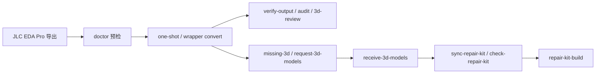

# JLC EDA Pro -> Cadence 17.4 快速指南

这份指南只保留最常用路径：把 JLC EDA Pro 导出转换成 Cadence 17.4 可用的 symbol、footprint、3D 模型映射和验收报告。



## 1. 一条命令转换

Windows 下推荐先用包装脚本：

```powershell
.\tools\jlc2cadence_workflow.ps1 `
  -Mode convert `
  -Input .\jlc_export `
  -Models .\models `
  -Out .\out_real `
  -RunCadence `
  -RequireCadence `
  -Strict
```

也可以直接使用 Python CLI：

```powershell
jlc2cadence one-shot `
  --input .\jlc_export `
  --models .\models `
  --out .\out_real `
  --run-cadence `
  --require-cadence `
  --strict
```

当你已经在使用 repair kit 时：

```powershell
jlc2cadence repair-kit-build `
  --repair-kit .\models\repair_kit `
  --model-root .\vendor_models `
  --out .\out_real `
  --run-cadence `
  --require-cadence `
  --require-3d `
  --strict
```

## 2. 3D 不全时

先生成补模型工作包：

```powershell
jlc2cadence missing-3d --input .\jlc_export --models .\models --repair-kit .\models\repair_kit
```

再生成给供应商回填的请求包：

```powershell
jlc2cadence request-3d-models `
  --repair-kit .\models\repair_kit `
  --build-out .\out_real `
  --allow-noncomponent-3d-exceptions `
  --write
```

供应商返回 CSV / JSON / XLSX 和 STEP/STP 文件后，把模型放到 `.\vendor_returns`，再签回 repair kit：

```powershell
.\tools\jlc2cadence_workflow.ps1 `
  -Mode receive-3d `
  -RepairKit .\models\repair_kit `
  -Request .\models\repair_kit\3d_model_request.csv `
  -VendorReturns .\vendor_returns `
  -Strict
```

等价的 CLI 命令：

```powershell
jlc2cadence receive-3d-models `
  --repair-kit .\models\repair_kit `
  --request .\models\repair_kit\3d_model_request.csv `
  --model-root .\vendor_returns `
  --strict
```

接着同步和检查：

```powershell
jlc2cadence sync-repair-kit --repair-kit .\models\repair_kit --strict
jlc2cadence check-repair-kit --repair-kit .\models\repair_kit --strict
```

## 3. 验收命令

Cadence symbol / footprint 就绪检查：

```powershell
jlc2cadence verify-output --out .\out_real --require-cadence --strict --write
jlc2cadence audit --out .\out_real --require-cadence --write
```

完整 3D 检查：

```powershell
jlc2cadence verify-output --out .\out_real --require-cadence --require-3d --strict --write
jlc2cadence validate-3d --out .\out_real --require-mapped --require-facet --strict --write
jlc2cadence 3d-review --out .\out_real --strict --write
```

如果 Cadence STEP mapping 已经完成并保存，可以用包装脚本一次刷新验收报告并调用 `update-3d`：

```powershell
.\tools\jlc2cadence_workflow.ps1 `
  -Mode verify `
  -Out .\out_real `
  -RequireCadence `
  -Require3D `
  -Update3D `
  -Strict
```

## 4. 重要规则

- 生产用 3D 只接受精确匹配的 vendor / JLC STEP / STP。
- 不要把占位模型、相邻封装、相邻 pin 数或手工改邻近模型当成正式 3D 交付。
- 安装孔、螺丝孔和 test point 这类非元器件，只有在明确审计时才使用 `--allow-noncomponent-3d-exceptions`。
- OBJ 可以作为参考资产保留，但完整 Cadence 3D 交付以 STEP/STP 为准。

## 5. 常用三条

```powershell
jlc2cadence one-shot --input .\jlc_export --models .\models --out .\out_real --run-cadence --require-cadence --strict
jlc2cadence request-3d-models --repair-kit .\models\repair_kit --write
jlc2cadence receive-3d-models --repair-kit .\models\repair_kit --request .\models\repair_kit\3d_model_request.csv --model-root .\vendor_returns --strict
```

